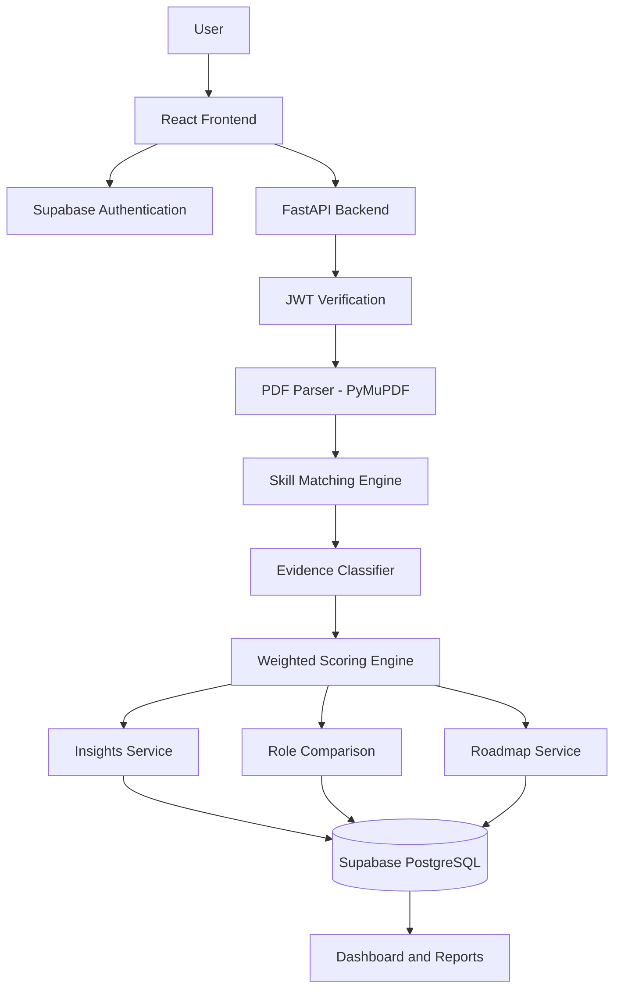

# SkillSync — From Potential to Proof.

**Evidence-Based Resume Analysis & Career Readiness Platform**

Understand what your resume proves. Discover what it needs. Build a stronger career profile.


---

## 📖 Table of Contents

- [🌌 The Vision Behind SkillSync](#-the-vision-behind-skillsync)
- [⚡ The Problem](#-the-problem)
- [💡 The SkillSync Approach](#-the-skillsync-approach)
- [✨ Core Features](#-core-features)
- [🧠 Evidence Intelligence Engine](#-evidence-intelligence-engine)
- [📊 Resume Evidence Scoring Model](#-resume-evidence-scoring-model)
- [🔍 Skill Gap Analysis](#-skill-gap-analysis)
- [🗺️ Personalized Learning Roadmap](#️-personalized-learning-roadmap)
- [🏗️ System Architecture](#️-system-architecture)
- [🛠️ Technology Stack](#️-technology-stack)
- [📂 Project Structure](#-project-structure)
- [🔐 Security & Data Protection](#-security--data-protection)
- [🚀 Getting Started](#-getting-started)
- [🔌 API Reference](#-api-reference)
- [🧪 Testing](#-testing)
- [⚠️ Current Limitations](#️-current-limitations)
- [🔮 Future Roadmap](#-future-roadmap)
- [👩‍💻 Author](#-author)

---

## 🌌 The Vision Behind SkillSync

A resume is more than a document. It is a representation of a person's skills, experiences, projects, and potential.

However, students and fresh graduates often struggle to understand whether their resumes actually demonstrate the skills expected by their target job roles.

**SkillSync bridges the gap between having skills and demonstrating those skills through meaningful resume evidence.**

It helps users analyze their resumes against selected job roles, understand how individual skills are represented, identify evidence gaps, compare career opportunities, and follow structured improvement recommendations.

> From Potential to Proof — turning resume analysis into actionable career growth.

## ⚡ The Problem

Traditional resume checkers often focus heavily on keyword matching.

A skill appearing in a resume does not necessarily mean that the candidate has demonstrated it through practical work.

For example:

| Resume Content | What It Demonstrates |
|---|---|
| Java listed under Skills | Limited evidence |
| Java mentioned in coursework | Supporting evidence |
| Java used in a project with implementation details | Stronger evidence |

This creates several challenges:

- Students cannot easily understand the quality of their resume evidence.
- Keyword-based matching may overestimate skill representation.
- Generic resume scores do not explain individual skill gaps.
- Users often receive suggestions without a clear improvement path.
- Comparing multiple job roles becomes difficult.

## 💡 The SkillSync Approach

SkillSync introduces an evidence-based resume analysis approach.

Instead of simply checking whether a keyword exists, it evaluates the context in which a skill appears.

The platform connects four important stages:

1. **Analyze:** Extract resume text and identify relevant skills.
2. **Understand:** Classify how strongly each skill is supported by resume evidence.
3. **Compare:** Evaluate the resume against multiple job roles.
4. **Improve:** Generate actionable recommendations and a personalized roadmap.

The goal is not to judge a person's actual ability from a PDF. It is to understand how effectively the resume communicates that ability.

---

## ✨ Core Features

### 1. 📄 Resume Analysis

- Upload resumes in PDF format.
- Validate file type and file size.
- Extract readable PDF text using PyMuPDF.
- Identify skills using a canonical skill dictionary and aliases.
- Analyze resume evidence against configured job roles.
- Generate a weighted evidence coverage score.
- Save analysis results for future reference.

### 2. 🧠 Skill Evidence Insights

Understand exactly how each required skill appears in your resume.

- Individual skill-level explanations.
- Strong, Supported, Limited, and Missing evidence classifications.
- Supporting resume passages.
- Evidence-based improvement suggestions.
- Skill evidence distribution.
- Clear distinction between demonstrated resume evidence and actual ability.

### 3. ⚖️ Multi-Role Comparison

Compare your resume against multiple career opportunities.

- Compare 2–4 job roles simultaneously.
- Evaluate each role using its own skill requirements.
- Display role-wise evidence scores.
- Identify supported skills and missing evidence.
- Highlight the strongest resume match.
- Save and revisit comparison results.

### 4. 🎯 Intelligent Skill Gap Analysis

Identify the difference between required skills and available resume evidence.

- Discover skills without sufficient resume evidence.
- Identify skills that need stronger project descriptions.
- Separate resume presentation gaps from potential learning gaps.
- Recommend meaningful next steps for each skill.

### 5. 🗺️ Personalized Learning Roadmap

Turn analysis results into actionable recommendations.

Three recommendation categories:

| Category | Purpose |
|---|---|
| Improve Resume Evidence | Better demonstrate an existing skill through meaningful project or experience details |
| Practise Existing Skill | Strengthen practical understanding through exercises and implementation |
| Develop New Skill | Build knowledge in a skill not currently supported by the resume |

Track progress using:

- Not Started
- In Progress
- Completed

Roadmap progress is saved and associated with the user's account.

### 6. 📚 Learning Resources

A dedicated resource section to support skill development.

- Curated learning resources.
- Official documentation links.
- Recognized free learning platforms.
- Skill-based resource filtering.
- Resource metadata and descriptions.

Opening a learning resource does not automatically change a skill's evidence classification.

### 7. 📈 Analysis History & Dashboard

- View previous resume analyses.
- Access saved reports.
- Revisit skill insights.
- Track roadmap recommendations.
- Navigate between dashboard modules.

---

## 🧠 Evidence Intelligence Engine

The central differentiator of SkillSync is its contextual evidence classification system.

Each identified skill is evaluated according to how it is represented in the resume.

### Four Evidence Levels

| Evidence Level | Description | Weight |
|---|---|---:|
| 🟢 Strong | Skill demonstrated through a project or work experience with clear implementation context | 1.0 |
| 🔵 Supported | Relevant contextual mention in projects, coursework, or responsibilities | 0.7 |
| 🟡 Limited | Skill mentioned in a standalone skills list without supporting explanation | 0.3 |
| ⚪ Missing | No matching resume evidence identified | 0.0 |

### Example

Consider a job role requiring Java, React, SQL, Python, and Git.

A candidate's resume might demonstrate:

- Java through a project implementation.
- React through a project description.
- SQL through coursework.
- Python only in the skills section.
- No identifiable Git evidence.

SkillSync classifies each skill based on the available resume content rather than treating every keyword equally.

This makes the analysis more informative than a simple keyword count.

---

## 📊 Resume Evidence Scoring Model

SkillSync calculates an evidence coverage score using weighted skill evidence.

**Formula:**

```text
Evidence Coverage Score =

(Sum of Evidence Weights / Total Required Skills) × 100
```

### Example Calculation

Suppose a job role requires five skills:

| Skill | Evidence Level | Weight |
|---|---|---:|
| Java | Strong | 1.0 |
| React | Supported | 0.7 |
| SQL | Strong | 1.0 |
| Python | Limited | 0.3 |
| Git | Missing | 0.0 |

```text
Total Evidence Weight = 1.0 + 0.7 + 1.0 + 0.3 + 0.0

Total Required Skills = 5

Score = (3.0 / 5) × 100

Evidence Coverage Score = 60%
```

**Important:** This is a heuristic resume evidence coverage score. It is not a hiring probability, an ATS approval score, or a verified measurement of real-world competency.

---

## 🔍 Skill Gap Analysis

SkillSync does not treat every missing skill as a learning problem.

It distinguishes between two different situations:

**1. Resume Evidence Gap**

The candidate may already know a skill, but the resume does not demonstrate it sufficiently.

Recommended action:
- Add meaningful project descriptions.
- Explain implementation details.
- Include relevant responsibilities and outcomes.

**2. Skill Development Gap**

The resume does not provide evidence that the required skill has been developed.

Recommended action:
- Learn the fundamentals.
- Practise through coding exercises.
- Build practical projects.
- Add meaningful implementation experience.

This distinction helps users improve both their resumes and their technical readiness.

---

## 🗺️ Personalized Learning Roadmap

The roadmap transforms skill analysis into structured improvement activities.

Each recommendation includes:

- Skill name.
- Evidence level.
- Recommendation category.
- Goal.
- Suggested action.
- Practical activity.
- Expected outcome.
- Progress status.

### Recommendation Lifecycle

```text
Resume Analysis
      |
      v
Skill Evidence Classification
      |
      v
Skill Gap Identification
      |
      v
Recommendation Generation
      |
      v
Personalized Roadmap
      |
      v
Track Improvement Progress
```

Users can update recommendation statuses and continue tracking their progress through the dashboard.

---

## 🏗️ System Architecture

SkillSync follows a frontend-backend architecture with Supabase authentication and PostgreSQL persistence.



### Analysis Workflow

1. User uploads a PDF resume.
2. Frontend validates the file.
3. Authenticated request reaches FastAPI.
4. Backend verifies the Supabase JWT.
5. PyMuPDF extracts resume text.
6. Skill matching identifies relevant skills.
7. Evidence classifier evaluates contextual mentions.
8. Scoring engine calculates evidence coverage.
9. Results are stored in Supabase.
10. Dashboard displays insights, comparisons, and roadmap recommendations.

---

## 🛠️ Technology Stack

### Frontend

| Technology | Purpose |
|---|---|
| React 19 | User interface |
| Vite 8 | Development and build tooling |
| TypeScript | Type safety |
| Tailwind CSS v4 | Styling |
| Lucide React | Icons |
| React Router v7 | Application navigation |
| Supabase JS v2 | Authentication and data integration |

### Backend

| Technology | Purpose |
|---|---|
| Python 3.13 | Backend language |
| FastAPI | REST API framework |
| PyMuPDF | PDF text extraction |
| Pydantic | Data validation |

### Database & Security

| Technology | Purpose |
|---|---|
| Supabase PostgreSQL | Persistent data storage |
| Supabase Auth | User authentication |
| JWT | Request authentication |
| Row Level Security | Database access protection |

---

## 📂 Project Structure

```text
SkillSync/
│
├── backend/
│   ├── app/
│   │   ├── api/
│   │   │   └── routes/
│   │   │       ├── health.py
│   │   │       ├── analysis.py
│   │   │       └── stage3.py
│   │   │
│   │   ├── repositories/
│   │   │   └── supabase_repository.py
│   │   │
│   │   ├── schemas/
│   │   │   ├── analysis.py
│   │   │   └── stage3.py
│   │   │
│   │   ├── services/
│   │   │   ├── analysis_service.py
│   │   │   ├── evidence_classifier.py
│   │   │   ├── insights_service.py
│   │   │   ├── learning_resources.py
│   │   │   ├── matching_engine.py
│   │   │   ├── pdf_parser.py
│   │   │   ├── roadmap_service.py
│   │   │   └── scoring_engine.py
│   │   │
│   │   └── main.py
│   │
│   ├── tests/
│   └── requirements.txt
│
├── src/
│   ├── components/
│   │   ├── analysis/
│   │   └── layout/
│   │
│   ├── pages/
│   │   └── dashboard/
│   │       ├── DashboardPage.tsx
│   │       ├── InsightsPage.tsx
│   │       ├── CompareRolesPage.tsx
│   │       ├── RoadmapPage.tsx
│   │       └── LearningResourcesPage.tsx
│   │
│   ├── services/
│   │   ├── analysis.ts
│   │   └── stage3.ts
│   │
│   └── types/
│       └── index.ts
│
└── README.md
```

---

## 🔐 Security & Data Protection

SkillSync uses authentication and ownership checks to protect user data.

- Supabase JWT verification through the authentication service.
- User identity is derived from the verified token.
- Backend ownership checks for user-specific records.
- Row Level Security is preserved.
- Supabase service role credentials remain backend-only.
- Uploaded resume content is not written to application logs.
- Temporary PDF processing uses file bytes rather than permanent public file storage.

---

## 🚀 Getting Started

### Prerequisites

Make sure you have:

- Node.js 18 or later.
- npm 9 or later.
- Python 3.11 or later.
- A Supabase project.
- Git installed.

### 1. Clone the Repository

```bash
git clone <your-repository-url>

cd SkillSync
```

### 2. Install Frontend Dependencies

```bash
npm install
```

### 3. Configure Frontend Environment

Create a `.env` file in the project root.

```env
VITE_SUPABASE_URL=your_supabase_project_url

VITE_SUPABASE_PUBLISHABLE_KEY=your_supabase_publishable_key

VITE_API_BASE_URL=http://127.0.0.1:8001/api
```

### 4. Configure Backend Environment

Create a `.env` file in the backend configuration location expected by your application.

```env
SUPABASE_URL=your_supabase_project_url

SUPABASE_SERVICE_ROLE_KEY=your_service_role_key

SUPABASE_ANON_KEY=your_supabase_anon_key
```

**Security note:** Never commit environment files or expose your service role key in frontend code or public repositories.

### 5. Install Backend Dependencies

```bash
pip install -r backend/requirements.txt
```

### 6. Start the Backend Server

Run from the project root:

```bash
uvicorn backend.app.main:app --reload --host 127.0.0.1 --port 8001
```

Backend API:

```text
http://127.0.0.1:8001
```

### 7. Start the Frontend

Open another terminal:

```bash
npm run dev
```

Frontend:

```text
http://localhost:5173
```

---

## 🔌 API Reference

| Method | Endpoint | Description |
|---|---|---|
| GET | `/api/health` | Backend health check |
| GET | `/api/stage3/insights/{analysis_id}` | Retrieve skill evidence insights |
| POST | `/api/stage3/compare` | Compare multiple job roles |
| POST | `/api/stage3/roadmaps?analysis_id=` | Generate roadmap recommendations |
| GET | `/api/stage3/roadmaps/analysis/{analysis_id}` | Retrieve roadmap for an analysis |
| PATCH | `/api/stage3/roadmaps/{roadmap_id}/recommendations/{rec_id}` | Update recommendation status |
| GET | `/api/stage3/learning-resources/{skill}` | Retrieve resources for a skill |
| GET | `/api/stage3/learning-resources?skills=A,B,C` | Retrieve resources for multiple skills |

---

## 🧪 Testing

SkillSync includes backend and frontend validation tests.

### Backend Tests

```bash
python -m pytest backend/tests/ -v
```

### Frontend Production Build

```bash
npm run build
```

### PDF Validator Tests

```bash
npm run test:validator
```

**Current test coverage:** 54 backend tests across the implemented analysis and Stage 3 functionality.

The backend tests use in-memory PDF data and local fallback behavior where applicable, so Supabase credentials are not required for those test cases.

---

## ⚠️ Current Limitations

SkillSync is an evolving project. The following limitations are acknowledged:

- Evidence classification currently uses rule-based logic and heuristics.
- The configured job-role catalog and skill taxonomy cover six roles.
- Scanned PDFs are not supported because OCR is not implemented.
- Evidence weights are heuristic and have not been validated against hiring outcomes.
- The system cannot independently verify real-world technical competency.
- Learning resources currently use a curated static catalog.
- Roadmap recommendations do not currently include deadlines or duration estimates.
- AI-powered recommendation generation is not currently implemented.

These limitations are important because SkillSync is designed to provide transparent resume evidence insights rather than make unsupported claims about a candidate's abilities.

---

## 🔮 Future Roadmap

Planned improvements include:

- Expanded job-role and skill taxonomy.
- More advanced contextual skill extraction.
- OCR support for scanned resumes.
- More detailed resume improvement suggestions.
- Expanded curated learning-resource library.
- Roadmap deadlines, milestones, and progress analytics.
- Improved automated end-to-end testing.
- Production deployment and performance optimization.
- Accessibility improvements and security hardening.

---

## 👩‍💻 Author

**Divyadharshini S**

B.Tech — Information Technology

Interested in Software Development, Artificial Intelligence, and building practical technology solutions.

GitHub: [@DIVYADHARSHINI1301](https://github.com/DIVYADHARSHINI1301)

---

<p align="center">

**SkillSync**

*From Potential to Proof.*

Building a clearer path between skills, evidence, and career readiness.

</p>
